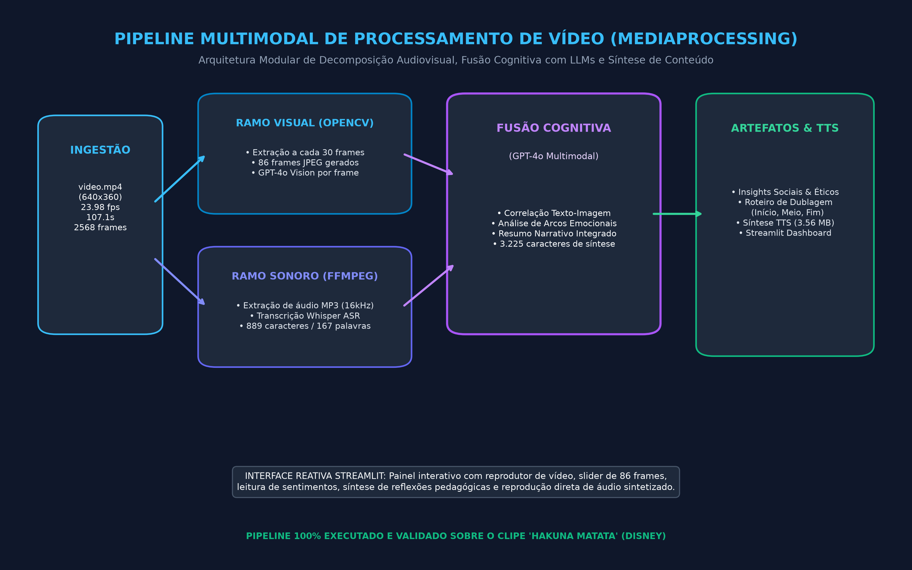
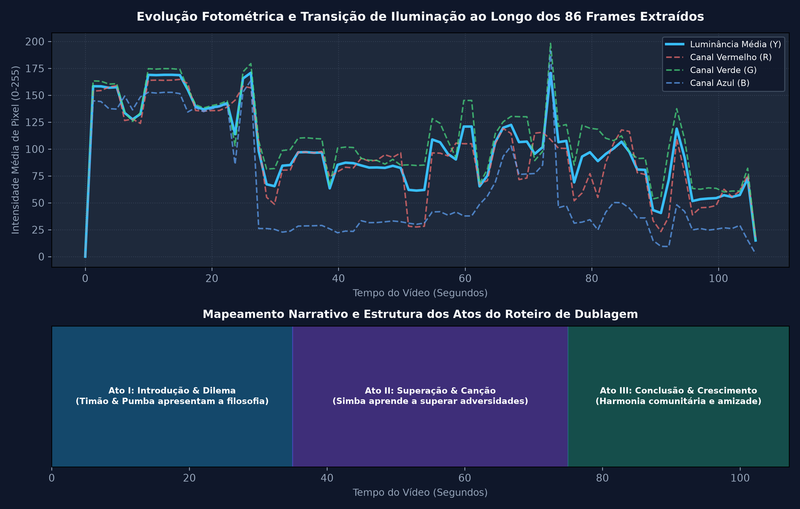

# 📽️ MediaProcessing – Plataforma de Análise Multimodal de Vídeo com IA Generativa

**MediaProcessing** é uma plataforma e pipeline modular de processamento audiovisual inteligente. O sistema automatiza a decomposição de vídeos em múltiplos fluxos de informação, orquestrando visão computacional (**OpenCV**), processamento de sinal acústico (**FFmpeg**), reconhecimento automático de fala (**Whisper ASR**), análise visual e semântica com modelos de linguagem multimodais (**OpenAI GPT-4o Vision**), geração de roteiros de dublagem adaptativa e síntese de voz (**TTS**), tudo centralizado em uma interface web reativa desenvolvida com **Streamlit**.

---

## 🏛️ Arquitetura do Pipeline Multimodal

O pipeline adota uma estrutura em grafo bifurcado com convergência cognitiva:



### Etapas e Módulos do Fluxo:
1. **Ingestão Audiovisual**: Recebe o vídeo original (`assets/video.mp4` – 640x360 pixels, 23.98 fps, 2.568 frames totais, 107.1 segundos de duração).
2. **Decomposição em Dois Ramos**:
   - **Ramo Visual (OpenCV)**: Amostragem temporal a cada 30 frames (1,25 segundo), gerando 86 imagens JPEG balanceadas.
   - **Ramo Sonoro (FFmpeg)**: Extração da faixa de áudio em canal mono mono-canal e frequência de 16 kHz (`outputs/audio.mp3` – 314,4 KB).
3. **Extração de Sinais com IA**:
   - **Transcrição Fonética (Whisper)**: Conversão acústica para texto estruturado (`outputs/transcription.txt` – 889 caracteres, 167 palavras).
   - **Análise Semântica de Texto (GPT-4o)**: Extração de resumo, tópicos-chave e tom emocional (`outputs/analysis.json`).
   - **Inspeção Visual por Frame (GPT-4o Vision)**: Descrição detalhada do conteúdo cênico, personagens e iluminação dos 86 frames (`outputs/frames_analysis.json`).
4. **Fusão Cognitiva Multimodal**: Cruzamento das transcrições com as descrições visuais para reconstrução de contexto, arcos emocionais e metáforas narrativas (`outputs/multimodal_understanding.json` – 3.225 caracteres).
5. **Geração de Artefatos Downstream**:
   - **Insights e Reflexões**: Extração de lições éticas, educacionais e socioemocionais (`outputs/insights.json`).
   - **Roteiro de Dublagem Narrativa**: Criação de roteiro adaptado em três atos — Início, Meio e Fim (`outputs/dubbing_script.txt` – 2.140 caracteres).
   - **Síntese de Voz (TTS)**: Conversão do roteiro em faixa de áudio de alta fidelidade (`outputs/dubbing_audio.mp3` – 3,56 MB).
6. **Interface Reativa (Streamlit)**: Dashboard interativo (`app.py`) com player de vídeo, carrossel de frames com slider, visualizador de metadados e player de áudio integrado.

---

## 📊 Análise Fotométrica e Mapeamento Temporal dos Frames

Abaixo está a curva de evolução fotométrica (luminância Y e canais RGB) dos 86 frames extraídos ao longo da linha do tempo do vídeo:



### Métricas Computacionais Extraídas:
- **Frame 0005 (04,1s)**: R=126.5, G=134.1, B=149.2 | Luminância Y=133.6 (cena aberta diurna com céu claro).
- **Frame 0025 (20,8s)**: R=80.4, G=98.6, B=22.7 | Luminância Y=84.5 (ambiente de selva densa com vegetação escura).
- **Frame 0055 (45,8s)**: R=71.6, G=130.0, B=76.4 | Luminância Y=106.4 (predomínio de folhagens e luz filtrada).
- **Frame 0080 (66,7s)**: R=47.5, G=63.5, B=25.4 | Luminância Y=54.4 (cena sombreada noturna/crepuscular).

---

## 🛠️ Tecnologias e Bibliotecas Utilizadas

| Componente | Tecnologia | Papel no Pipeline |
| :--- | :--- | :--- |
| **Interface Interativa** | Streamlit 1.65+ | Dashboard web reativo com players de mídia e sliders |
| **Visão Computacional** | OpenCV 4.10+ (`cv2`) | Decodificação do vídeo, amostragem e escrita de frames |
| **Processamento de Áudio** | FFmpeg & `ffmpeg-python` | Separação de canais, normalização de taxa de amostragem |
| **IA de Fala (ASR)** | OpenAI Whisper | Transcrição fonética de alta fidelidade |
| **IA de Visão & Texto** | OpenAI GPT-4o / GPT-4o Vision | Análise visual por imagem e síntese de contexto multimodal |
| **Síntese de Fala (TTS)** | OpenAI TTS Engine | Geração de narração humana a partir do roteiro |
| **Manipulação de Imagens** | Pillow (PIL) & NumPy | Álgebra linear de pixels e exibição gráfica |

---

## 📁 Estrutura de Diretórios e Artefatos

```
mediaProcessing/
├── assets/
│   └── video.mp4                   # Vídeo de entrada (107.1s, 4.86 MB)
├── outputs/
│   ├── frames/                     # 86 frames JPEG extraídos pelo OpenCV
│   ├── audio.mp3                   # Trilha de áudio extraída pelo FFmpeg (314 KB)
│   ├── transcription.txt           # Transcrição gerada pelo Whisper (889 chars)
│   ├── analysis.json               # Análise textual de sentimentos e tópicos
│   ├── frames_analysis.json        # Análise visual detalhada dos 86 frames
│   ├── multimodal_understanding.json # Síntese cognitiva combinada (3.225 chars)
│   ├── insights.json               # Reflexões pedagógicas e socioemocionais
│   ├── dubbing_script.txt          # Roteiro de narração em 3 atos
│   └── dubbing_audio.mp3           # Áudio sintetizado de dublagem (3.56 MB)
├── evidencias/                     # Evidências gráficas e logs da validação real
├── app.py                          # Aplicação web Streamlit completa
├── main.py                         # Orquestrador do pipeline via terminal
└── requirements.txt                # Dependências Python
```

---

## 🚀 Como Executar Localmente

### 1. Instalar Dependências
```bash
pip install -r requirements.txt
```

### 2. Configurar Chave de API da OpenAI
Crie um arquivo `.env` na raiz do projeto:
```env
OPENAI_API_KEY=sk-sua-chave-aqui
```

### 3. Iniciar o Dashboard Streamlit
```bash
streamlit run app.py
```
O navegador abrirá automaticamente em `http://localhost:8501`.
